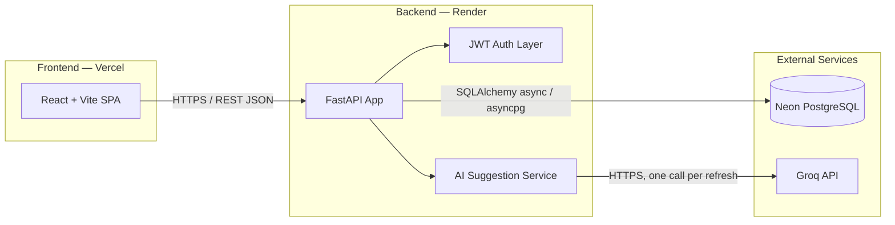
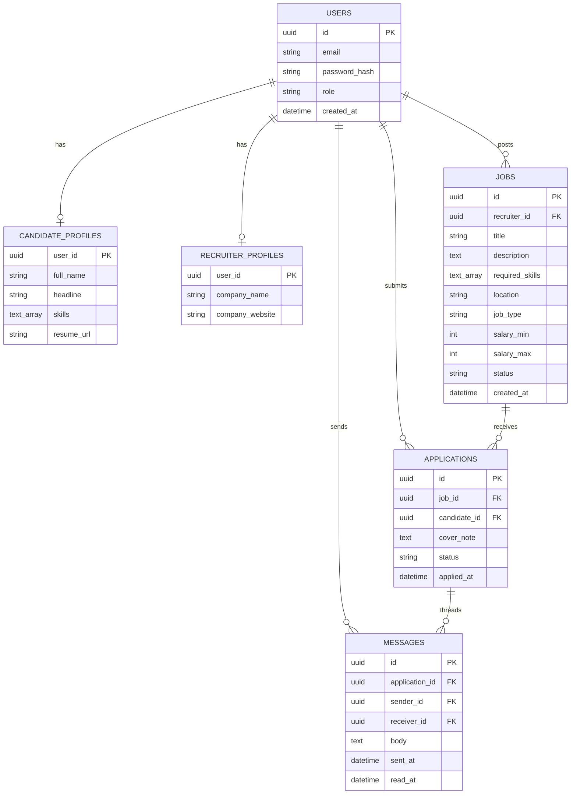
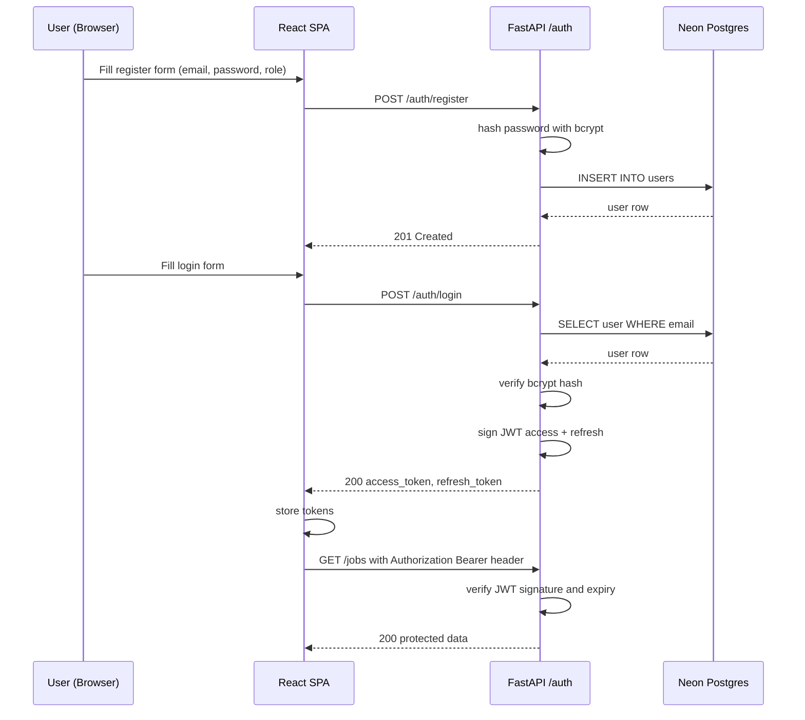
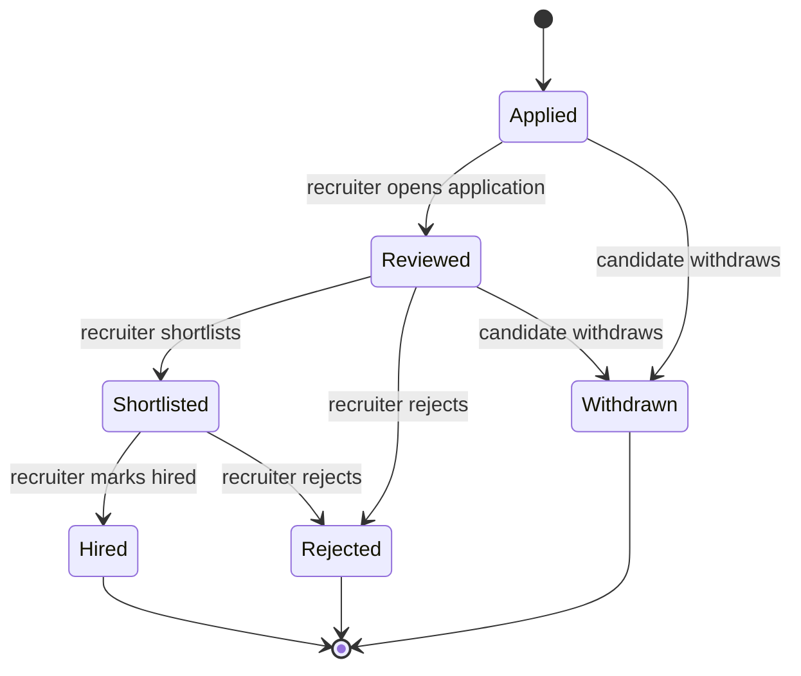
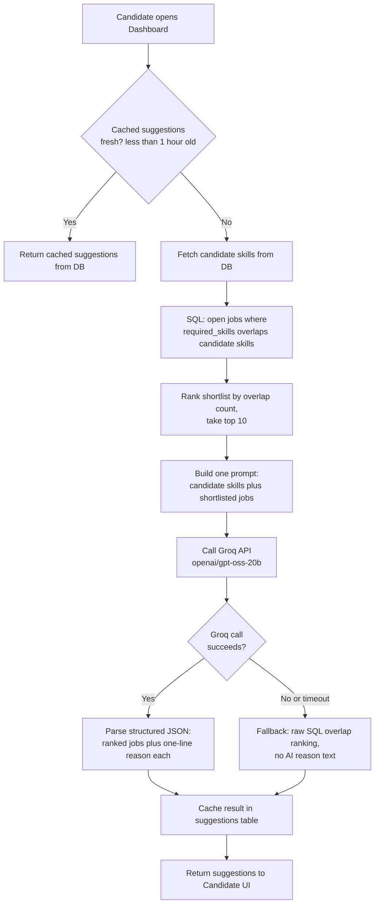

# Job Portal Application — Product & Technical Specification

**Stack:** FastAPI + React (Vite) + PostgreSQL (Neon) · JWT Auth · Groq-powered AI Suggestions
**Deploy:** Backend → Render · Frontend → Vercel · Database → Neon (free, 0.5 GB)
**Author:** CodeJBorg | **Version:** 1.0 | **Status:** Draft for build

---

## Table of Contents

1. [Overview](#1-overview)
2. [Tech Stack](#2-tech-stack)
3. [System Architecture](#3-system-architecture)
4. [User Roles](#4-user-roles)
5. [Epics & User Stories](#5-epics--user-stories)
6. [Functional Requirements Summary](#6-functional-requirements-summary)
7. [Non-Functional Requirements](#7-non-functional-requirements)
8. [Out of Scope for MVP](#8-out-of-scope-for-mvp)
9. [Database Schema](#9-database-schema)
10. [API Endpoints](#10-api-endpoints)
11. [Flows](#11-flows)
12. [AI Suggestion Engine — Design Reasoning](#12-ai-suggestion-engine--design-reasoning)
13. [Environment Variables](#13-environment-variables)
14. [Local Development Setup](#14-local-development-setup)
15. [Deployment Guide](#15-deployment-guide)
16. [Folder Structure](#16-folder-structure)
17. [Suggested Build Order](#17-suggested-build-order)
18. [Assumptions Made](#18-assumptions-made)
19. [Future Enhancements](#19-future-enhancements)

---

## 1. Overview

A lightweight job portal where **recruiters** post jobs and **candidates** browse, apply, and message recruiters. Each candidate additionally sees a personalized, AI-ranked list of job suggestions based on their skill profile, generated via the Groq API.

Design principle for this whole spec: **simple > clever**. No microservices, no message queue, no vector DB, no agent framework — one FastAPI monolith, one React SPA, one Postgres database, one external AI call.

## 2. Tech Stack

| Layer | Technology | Notes |
|---|---|---|
| Backend framework | FastAPI (Python 3.12) | async, auto Swagger docs at `/docs` |
| ORM / migrations | SQLAlchemy 2.0 (async) + Alembic | |
| Database | PostgreSQL via **Neon** | free tier: 0.5 GB storage, 100 compute-hrs/month |
| Auth | JWT (`PyJWT`) + `bcrypt` (direct, not `passlib`) | access + refresh token pair |
| Frontend framework | React 18 + Vite + TypeScript | |
| HTTP / data-fetching | Axios + React Query (optional but recommended) | React Query gives free caching for suggestions/applications |
| Styling | Tailwind CSS (optional) | any CSS approach works |
| AI | Groq API — `openai/gpt-oss-20b` (default) | fast + cheap; swap to `openai/gpt-oss-120b` for higher-quality reasoning |
| Backend hosting | Render (free Web Service) | sleeps after 15 min idle, ~30-60s cold start |
| Frontend hosting | Vercel | static SPA build |
| DB hosting | Neon | serverless Postgres, scale-to-zero |

> Note: Llama models on Groq (`llama-3.3-70b-versatile`, `llama-3.1-8b-instant`) are deprecated — use the `openai/gpt-oss-*` models shown above.

## 3. System Architecture



## 4. User Roles

- **Candidate** — browses jobs, applies, messages recruiters, sees AI suggestions.
- **Recruiter** — posts jobs, reviews applicants, messages candidates.

A single `users` table holds both, distinguished by a `role` column (see [§9](#9-database-schema)). No separate Admin role for MVP.

## 5. Epics & User Stories

### EP-1: Authentication & Account Management
| ID | Story | Acceptance Criteria |
|---|---|---|
| US-1.1 | As a new user, I can register as a Candidate or Recruiter with email + password. | Email is unique; password is hashed with bcrypt before storage; role is required at signup. |
| US-1.2 | As a user, I can log in and receive tokens. | Returns short-lived access token (30 min) + refresh token (7 days). |
| US-1.3 | As a user, I can refresh my session without re-entering credentials. | `POST /auth/refresh` issues a new access token from a valid refresh token. |
| US-1.4 | As a user, I can view and update my profile. | Candidate: name, headline, skills, resume link. Recruiter: company name, website. |

### EP-2: Recruiter — Job Posting
| ID | Story | Acceptance Criteria |
|---|---|---|
| US-2.1 | As a recruiter, I can create a job post. | Requires title, description, required skills (tags), location, job type; salary range optional. |
| US-2.2 | As a recruiter, I can edit or close my own job post. | Only the owning recruiter can modify; closed jobs stop accepting applications. |
| US-2.3 | As a recruiter, I can view the list of applicants for a job. | Shows candidate name, skills, cover note, applied date, status. |
| US-2.4 | As a recruiter, I can change an application's status. | Statuses: Applied → Reviewed → Shortlisted/Rejected → Hired. |

### EP-3: Candidate — Job Discovery & Application
| ID | Story | Acceptance Criteria |
|---|---|---|
| US-3.1 | As a candidate, I can browse and filter job posts. | Filters: keyword, skill tag, location, job type. |
| US-3.2 | As a candidate, I can apply to a job with a short cover note. | One application per candidate per job (unique constraint). |
| US-3.3 | As a candidate, I can view all my applications and their status. | Sorted by most recent. |
| US-3.4 | As a candidate, I can withdraw an application. | Only allowed before status reaches Hired/Rejected. |

### EP-4: Messaging
| ID | Story | Acceptance Criteria |
|---|---|---|
| US-4.1 | As a candidate, I can message a recruiter about a specific application. | Message thread is scoped to one `application_id`. |
| US-4.2 | As a recruiter, I can reply to a candidate's message. | Only the two parties on that application can read/write the thread. |
| US-4.3 | As a user, I can see unread message indicators. | Simple polling (e.g. every 15-30s) or refetch-on-focus is enough for MVP — no WebSocket needed. |

### EP-5: AI-Based Job Suggestions
| ID | Story | Acceptance Criteria |
|---|---|---|
| US-5.1 | As a candidate, I see a "Recommended for you" list on my dashboard. | Ranked list of up to 10 open jobs relevant to my skills. |
| US-5.2 | As a candidate, each suggestion shows a short reason. | e.g. "Matches your React and Node.js experience." Generated once per refresh, not per page load. |
| US-5.3 | As a candidate, suggestions update when my skills change or new jobs appear. | Cache invalidated on profile update; otherwise refreshed on a time interval (e.g. hourly) to conserve API calls. |

## 6. Functional Requirements Summary

| FR-ID | Requirement | Epic |
|---|---|---|
| FR-1 | Passwords are never stored in plain text; bcrypt hash only. | EP-1 |
| FR-2 | All protected routes require a valid JWT in `Authorization: Bearer`. | EP-1 |
| FR-3 | Role-based access: only recruiters can create/edit jobs; only candidates can apply. | EP-2, EP-3 |
| FR-4 | A job post cannot be edited or deleted by a recruiter who doesn't own it. | EP-2 |
| FR-5 | A candidate cannot apply twice to the same job. | EP-3 |
| FR-6 | Applications carry a status enum enforced server-side. | EP-2, EP-3 |
| FR-7 | Messages are only visible to the two parties on the linked application. | EP-4 |
| FR-8 | AI suggestions are generated server-side; the frontend never calls Groq directly. | EP-5 |
| FR-9 | If the Groq call fails or times out, the system falls back to plain SQL skill-overlap ranking (no broken UI). | EP-5 |
| FR-10 | Suggestion results are cached per candidate to avoid one Groq call per page load. | EP-5 |

## 7. Non-Functional Requirements

- **Security:** bcrypt password hashing; short-lived access tokens; CORS restricted to known frontend origins; all input validated via Pydantic models; secrets only in environment variables, never in git.
- **Simplicity:** single backend service, single frontend app, no queue/cache infra beyond Postgres itself.
- **Cost:** entire stack runs on free tiers (Neon free DB, Render free web service, Vercel free hosting, Groq free developer tier).
- **Acceptable latency trade-offs:** Render free tier cold start (~30-60s after 15 min idle) and Neon cold start (~500ms after scale-to-zero) are acceptable for an MVP/portfolio project; upgrade to paid always-on tiers only if real users need it.
- **Portability:** the same codebase runs unchanged in local dev and production — only `.env` values differ.

## 8. Out of Scope for MVP

To keep this simple, the following are intentionally **not** built in v1:

- Admin role / moderation panel
- Email verification or password-reset flow
- Resume file upload & parsing
- Real-time WebSocket chat (polling is enough)
- Payment/subscription billing
- Push/email notifications
- Semantic (embedding-based) skill matching — see [§19](#19-future-enhancements)

## 9. Database Schema



**Notes:**
- `skills` and `required_skills` are Postgres `TEXT[]` columns with a **GIN index** each, so matching uses the native array-overlap operator: `WHERE jobs.required_skills && candidate.skills`. This avoids a separate skills/tags join table while staying fast at MVP scale.
- `messages.application_id` scopes every conversation to one specific job application — simpler than a general inbox, and it naturally answers "who is allowed to see this thread."
- `applications.status` enum: `applied`, `reviewed`, `shortlisted`, `rejected`, `hired`, `withdrawn`.
- `jobs.status` enum: `open`, `closed`.

## 10. API Endpoints

### Auth
| Method | Path | Auth | Description |
|---|---|---|---|
| POST | `/auth/register` | Public | Register as candidate or recruiter |
| POST | `/auth/login` | Public | Returns access + refresh token |
| POST | `/auth/refresh` | Refresh token | Returns new access token |
| GET | `/auth/me` | Bearer | Current user + profile |
| PUT | `/auth/me` | Bearer | Update profile |

### Jobs
| Method | Path | Auth | Description |
|---|---|---|---|
| GET | `/jobs` | Public | List/search/filter open jobs |
| GET | `/jobs/{job_id}` | Public | Job detail |
| POST | `/jobs` | Recruiter | Create job post |
| PUT | `/jobs/{job_id}` | Recruiter (owner) | Edit job post |
| DELETE | `/jobs/{job_id}` | Recruiter (owner) | Close/delete job post |
| GET | `/jobs/{job_id}/applications` | Recruiter (owner) | List applicants for a job |

### Applications
| Method | Path | Auth | Description |
|---|---|---|---|
| POST | `/applications` | Candidate | Apply to a job `{job_id, cover_note}` |
| GET | `/applications/me` | Candidate | My applications |
| PATCH | `/applications/{id}/status` | Recruiter (owner of job) | Update application status |
| DELETE | `/applications/{id}` | Candidate (owner) | Withdraw application |

### Messages
| Method | Path | Auth | Description |
|---|---|---|---|
| GET | `/applications/{id}/messages` | Both parties | Fetch thread |
| POST | `/applications/{id}/messages` | Both parties | Send a message |

### AI Suggestions
| Method | Path | Auth | Description |
|---|---|---|---|
| GET | `/suggestions` | Candidate | Ranked, AI-explained job suggestions |

## 11. Flows

### 11.1 Auth Flow



### 11.2 Application Status Lifecycle



### 11.3 AI Suggestion Generation



## 12. AI Suggestion Engine — Design Reasoning

**Why not RAG?** RAG (Retrieval-Augmented Generation) solves "find relevant chunks in a large unstructured corpus, then generate a grounded answer." Job posts and candidate skills are already structured rows in Postgres — retrieval is a `WHERE ... && ...` query, not a semantic search problem. Adding a vector DB and embedding pipeline here would add infrastructure without adding accuracy.

**Why not MCP?** MCP lets an LLM agent choose which external tool to call, dynamically, across a conversation. This feature is one fixed task with one fixed output shape (ranked jobs + short reasons) — it doesn't need an agent deciding what to do next.

**What this design does instead — two stages:**

1. **Deterministic shortlist (SQL, free, instant):**
   ```sql
   SELECT id, title, required_skills,
          cardinality(required_skills & candidate_skills) AS overlap
   FROM jobs
   WHERE status = 'open'
     AND required_skills && :candidate_skills
   ORDER BY overlap DESC
   LIMIT 10;
   ```
2. **LLM ranking + explanation (Groq, one call):** send the candidate's skills and the 10 shortlisted jobs in a single prompt, and ask for strict JSON back:

   ```text
   System: You are a job-matching assistant. Given a candidate's skills and a
   list of shortlisted jobs, return ONLY valid JSON: an array of objects with
   job_id, rank, and a one-sentence reason (max 20 words) explaining the fit.
   Do not include any text outside the JSON array.

   User: Candidate skills: {skills}
   Jobs: {shortlisted_jobs_as_json}
   ```

   Model: `openai/gpt-oss-20b` (fast, cheap, plenty for a 10-item ranking task). Use `openai/gpt-oss-120b` only if you find the reasoning quality lacking.

**Reliability & cost controls:**
- **Cache** the result per candidate (a `suggestions` table or a `suggestions_cache` JSONB column keyed by candidate ID + a hash of their skills). Regenerate only when skills change or the cache is older than ~1 hour. This keeps you well within Groq's free-tier rate limits even with many candidates.
- **Fallback:** if the Groq call errors or times out, return the SQL-ranked shortlist without AI reasons rather than showing an error — the feature should degrade gracefully, not break the dashboard.
- **No embeddings needed** for MVP. If skill-tag matching later feels too literal (e.g. candidate lists "web development" but a job wants "React"), the natural upgrade is `pgvector` on Neon (already included free on every plan) — embed skill/job text with any small embedding model and do cosine-similarity search. That's a much smaller step up than full RAG, and only worth doing once literal tag matching proves insufficient.

## 13. Environment Variables

### Backend `.env`
```env
DATABASE_URL=postgresql+asyncpg://<user>:<password>@<neon-host>/<db>?sslmode=require
JWT_SECRET_KEY=<random 32+ byte hex string>
JWT_ALGORITHM=HS256
ACCESS_TOKEN_EXPIRE_MINUTES=30
REFRESH_TOKEN_EXPIRE_DAYS=7
GROQ_API_KEY=<your groq api key>
GROQ_MODEL=openai/gpt-oss-20b
CORS_ORIGINS=http://localhost:5173,https://your-app.vercel.app
ENV=development
```

### Frontend `.env`
```env
VITE_API_BASE_URL=http://localhost:8000
```

> The **same variable names** are reused in Render and Vercel dashboards for production — only the values change (production `DATABASE_URL` and `CORS_ORIGINS`, production `VITE_API_BASE_URL`). This is what makes local → deployed a non-event.

## 14. Local Development Setup

**Backend:**
1. `git clone <repo> && cd backend`
2. `python -m venv .venv && source .venv/bin/activate` (Windows: `.venv\Scripts\activate`)
3. `pip install -r requirements.txt`
4. Create a free Neon project at neon.tech → copy the **pooled connection string** → this is your `DATABASE_URL` (used both locally and in production — no need to install Postgres locally at all).
5. `cp .env.example .env` and fill in `DATABASE_URL`, `JWT_SECRET_KEY`, `GROQ_API_KEY`, `CORS_ORIGINS=http://localhost:5173`
6. `alembic upgrade head` — runs migrations against your Neon database
7. `uvicorn app.main:app --reload --port 8000`
8. Open `http://localhost:8000/docs` for the interactive Swagger UI

**Frontend:**
1. `cd frontend && npm install`
2. `cp .env.example .env.local` → set `VITE_API_BASE_URL=http://localhost:8000`
3. `npm run dev` → open `http://localhost:5173`

Because you're already pointing at the real Neon database in dev, there's no "seed data drifts from prod schema" problem — the schema is identical from day one.

## 15. Deployment Guide

### Step 1 — Neon (database)
1. Sign up at neon.tech, create a project (pick a region close to where you'll deploy Render, e.g. AWS `us-east-1`, to reduce latency).
2. Copy the **pooled connection string** (uses Neon's built-in PgBouncer — recommended since a web backend opens many short-lived connections).
3. Free tier gives 0.5 GB storage and 100 compute-hours/month with autoscaling up to 2 CU and scale-to-zero after idle — enough headroom for an MVP portal.
4. Optional: `CREATE EXTENSION IF NOT EXISTS vector;` now if you want `pgvector` ready for the future semantic-matching upgrade — it's free on every Neon plan, no rush to use it though.

### Step 2 — Render (backend)
1. Push the backend to GitHub.
2. Render dashboard → **New → Web Service** → connect the repo. If it's a monorepo, set **Root Directory** to `backend/`.
3. Runtime: **Python 3** · Build Command: `pip install -r requirements.txt` · Start Command: `uvicorn app.main:app --host 0.0.0.0 --port $PORT` (must use `$PORT`, not a hardcoded port).
4. Add environment variables from [§13](#13-environment-variables) in the Render dashboard.
5. Deploy → note the `https://<service>.onrender.com` URL.
6. Run `alembic upgrade head` once via Render's **Shell** tab (or wire it as a pre-deploy command) to create the schema.
7. Free-tier reality check: the service sleeps after 15 minutes idle; the next request takes ~30-60s to wake it. Fine for a demo/portfolio; move to the $7/mo always-on plan if real users depend on it.

### Step 3 — Vercel (frontend)
1. Push the frontend to GitHub.
2. Vercel dashboard → **Import Project** → framework preset auto-detects Vite. If monorepo, set **Root Directory** to `frontend/`.
3. Build Command: `npm run build` · Output Directory: `dist`.
4. Add env var `VITE_API_BASE_URL=https://<your-render-service>.onrender.com`.
5. Add `vercel.json` at the frontend root so client-side routes don't 404 on refresh:
   ```json
   {
     "rewrites": [{ "source": "/(.*)", "destination": "/index.html" }]
   }
   ```
6. Deploy → note the `https://<your-app>.vercel.app` URL.

### Step 4 — Wire the two together
1. Go back to Render → update `CORS_ORIGINS` to include the real Vercel URL → redeploy.
2. Confirm `VITE_API_BASE_URL` on Vercel already points at the Render URL from Step 3.
3. Test end-to-end: register, log in, post a job, apply, message, check AI suggestions.

## 16. Folder Structure

```text
job-portal/
├── backend/
│   ├── app/
│   │   ├── main.py
│   │   ├── core/            # config.py, security.py (jwt + bcrypt)
│   │   ├── db/               # session.py, base.py
│   │   ├── models/           # SQLAlchemy models
│   │   ├── schemas/          # Pydantic request/response schemas
│   │   ├── api/
│   │   │   ├── auth.py
│   │   │   ├── jobs.py
│   │   │   ├── applications.py
│   │   │   ├── messages.py
│   │   │   └── suggestions.py
│   │   └── services/
│   │       ├── ai_suggestions.py   # SQL shortlist + Groq call
│   │       └── matcher.py
│   ├── alembic/
│   ├── requirements.txt
│   └── .env.example
├── frontend/
│   ├── src/
│   │   ├── pages/             # Login, Register, Dashboard, JobDetail, PostJob, MyApplications, Messages
│   │   ├── components/
│   │   ├── api/                # axios client
│   │   ├── context/            # auth context
│   │   └── main.tsx
│   ├── vercel.json
│   ├── .env.example
│   └── package.json
└── README.md
```

## 17. Suggested Build Order

1. **Auth** (EP-1) — get register/login/JWT solid first, everything else depends on it.
2. **Job CRUD + browse** (EP-2, EP-3 partial) — recruiters post, candidates browse.
3. **Deploy the skeleton early** — wire up Neon + Render + Vercel with just auth + jobs working, before building messaging/AI. This proves the deployment pipeline while the app is still simple, instead of debugging deployment and features at once.
4. **Applications** (EP-3) — apply, withdraw, status updates.
5. **Messaging** (EP-4).
6. **AI Suggestions** (EP-5) — added last since it depends on jobs + candidate skills already existing.
7. Polish: loading states, empty states, basic responsive layout.

## 18. Assumptions Made

- Only two roles (Candidate, Recruiter) — no Admin for MVP.
- Skills are free-text tags (`TEXT[]`), not a curated/controlled taxonomy.
- Messaging is scoped per application, not a general-purpose inbox between any two users.
- Polling (or refetch-on-focus) is sufficient for messaging "real-time-ish" feel — no WebSocket infra.
- One application per candidate per job (re-applying isn't supported; withdraw and the record stays for history).
- AI suggestions are recomputed on a cache-expiry basis, not on every dashboard load.

## 19. Future Enhancements

- Real-time messaging via WebSockets (FastAPI supports this natively if you outgrow polling).
- Semantic skill matching using `pgvector` on Neon + a small embedding model, if literal tag-overlap stops being accurate enough.
- Resume upload + parsing to auto-fill candidate skills.
- Admin panel for moderation.
- Email notifications on application status change / new message.
- Saved searches / job alerts.
